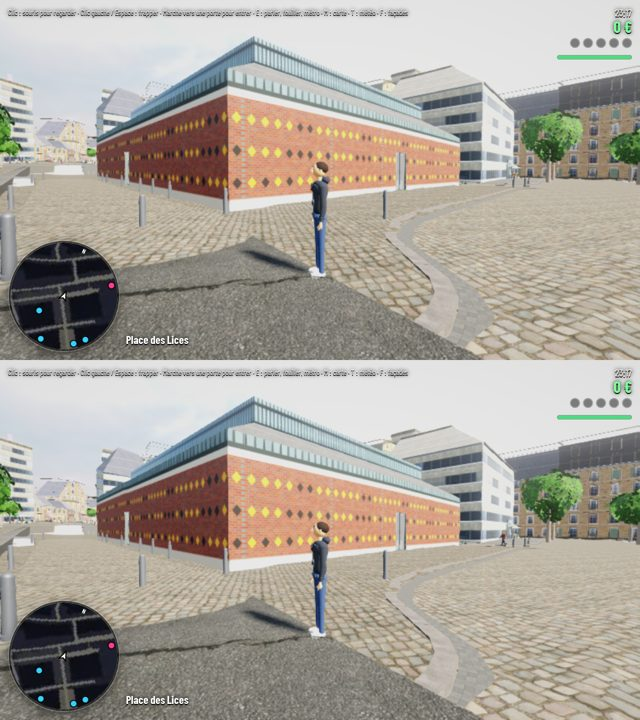
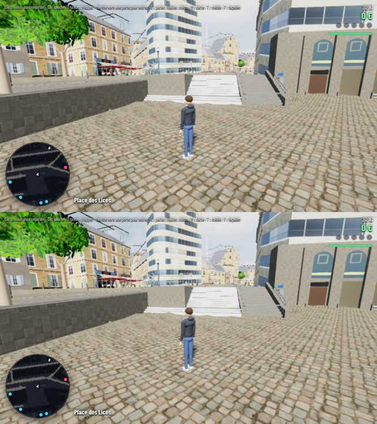

# Contrôle automatique — OK avec réserves

Commit `4616e66` · 2026-11-27 17:50 UTC · chargement 70 s · 0.305 images/s en rendu logiciel

## Réserves
- Rue Saint-Michel, jour : image délavée (luminosité moyenne 0.611, saturation 0.184 ; une photo de rue en plein jour tourne autour de 0,40-0,50 de luminosité et 0,20-0,30 de saturation).
- Place des Lices, escalier, jour : image délavée (luminosité moyenne 0.631, saturation 0.172 ; une photo de rue en plein jour tourne autour de 0,40-0,50 de luminosité et 0,20-0,30 de saturation).
- Halles des Lices, jour : image délavée (luminosité moyenne 0.649, saturation 0.159 ; une photo de rue en plein jour tourne autour de 0,40-0,50 de luminosité et 0,20-0,30 de saturation).

## Rendu
Images par seconde : 0.305 sur une machine de vitesse 11.619 (référence en construction, 2/3 contrôles).
**Changement visuel : limité.** 1 vue(s) sur 6 changent nettement (plus de 10 % de l'image).

## Missions
| Mission | Résultat |
|---|---|
| Mission 1 | OK |
| Mission 2 | OK |
| Mission 3 | OK |
| Mission 4 | OK |
| Mission 5 | OK |
| Mission 6 | OK |
| Mission 7 | OK |
| Mission 8 | OK |
| Mission 9 | OK |
| Fight club | OK |

## Accès aux éléments de mission
- OK — Mission 3 : les 3 sacs tirés sont accessibles à pied
- OK — Thabor (à pied, depuis la rue de Paris)
- OK — Thabor (en voiture, depuis le bd de la Duchesse-Anne)

## Vues fixes
Changement = part de l’image qui change nettement par rapport au contrôle précédent (moins de 10 % : anecdotique). Entre parenthèses : écart avec le contrôle précédent.

| Vue | Changement | Luminosité | Contraste | Saturation | Quasi blanc |
|---|---|---|---|---|---|
| Rue Maréchal Joffre, jour | 15 % | 0.518 (-0.001) | 0.226 (-0.007) | 0.272 (+0.004) | 4 % |
| Rue Saint-Michel, jour | 0 % | 0.611 (+0.0) | 0.193 (+0.0) | 0.184 (+0.0) | 10 % |
| Place des Lices, escalier, jour | 0 % | 0.631 (+0.0) | 0.155 (+0.0) | 0.172 (+0.0) | 8 % |
| Halles des Lices, jour | 0 % | 0.649 (+0.0) | 0.181 (+0.0) | 0.159 (+0.0) | 17 % |
| Place des Lices, nuit sous la pluie | 3 % | 0.217 (+0.0) | 0.141 (+0.0) | 0.354 (+0.0) | 0 % |
| Toits du centre vus d’en haut | 0 % | 0.666 (+0.0) | 0.149 (+0.0) | 0.152 (+0.0) | 4 % |

Comparaisons avant (en haut) / après (en bas) :

Captures actuelles :

---
Ce rapport est produit par `tests/ci.py` (workflow « Contrôle automatique »). Les règles de travail sont dans `AGENTS.md`.
