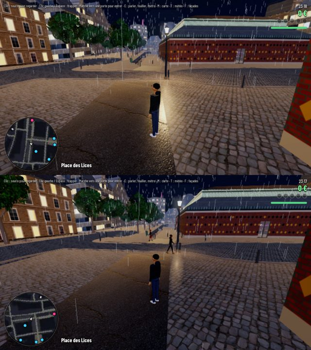
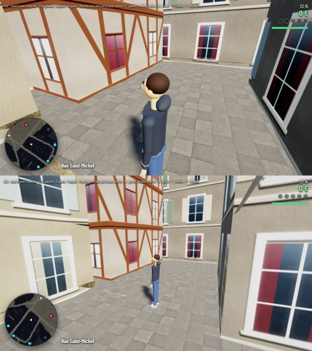
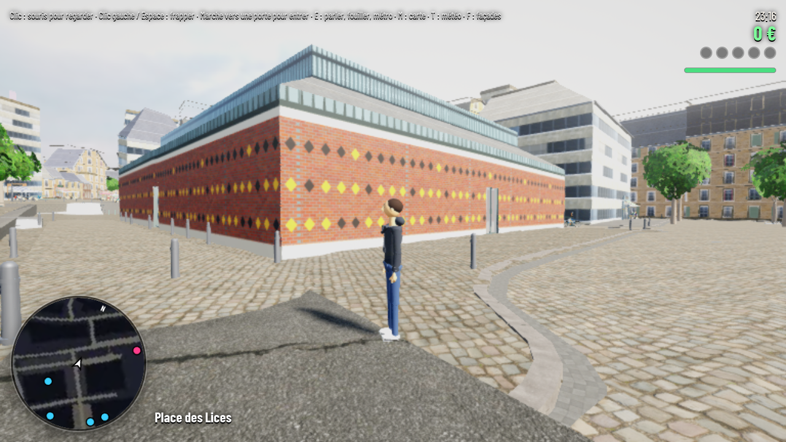

# Contrôle automatique — KO

Commit `18edf3a` · 2026-11-26 14:20 UTC · chargement 153 s · 0.38 images/s en rendu logiciel (précédent : 0.5)

## Bloquant (à corriger avant tout autre changement)
- Images par seconde en baisse de 24 % (0.5 → 0.38).

## Réserves
- Rue Saint-Michel, jour : image délavée (luminosité moyenne 0.611, saturation 0.184 ; une photo de rue en plein jour tourne autour de 0,40-0,50 de luminosité et 0,20-0,30 de saturation).
- Place des Lices, escalier, jour : image délavée (luminosité moyenne 0.631, saturation 0.172 ; une photo de rue en plein jour tourne autour de 0,40-0,50 de luminosité et 0,20-0,30 de saturation).
- Halles des Lices, jour : image délavée (luminosité moyenne 0.648, saturation 0.158 ; une photo de rue en plein jour tourne autour de 0,40-0,50 de luminosité et 0,20-0,30 de saturation).

## Rendu
**Changement visuel : net.** 5 vues sur 6 changent nettement. Regarder les comparaisons pour juger si c'est mieux.

## Missions
| Mission | Résultat |
|---|---|
| Mission 1 | OK |
| Mission 2 | OK |
| Mission 3 | OK |
| Mission 4 | OK |
| Mission 5 | OK |
| Mission 6 | OK |
| Mission 7 | OK |
| Mission 8 | OK |
| Mission 9 | OK |
| Fight club | OK |

## Accès aux éléments de mission
- OK — Mission 3 : les 3 sacs tirés sont accessibles à pied
- OK — Thabor (à pied, depuis la rue de Paris)
- OK — Thabor (en voiture, depuis le bd de la Duchesse-Anne)

## Vues fixes
Changement = part de l’image qui change nettement par rapport au contrôle précédent (moins de 10 % : anecdotique). Entre parenthèses : écart avec le contrôle précédent.

| Vue | Changement | Luminosité | Contraste | Saturation | Quasi blanc |
|---|---|---|---|---|---|
| Rue Maréchal Joffre, jour | 26 % | 0.528 (+0.013) | 0.226 (-0.006) | 0.248 (-0.024) | 4 % |
| Rue Saint-Michel, jour | 54 % | 0.611 (+0.073) | 0.193 (-0.026) | 0.184 (-0.008) | 10 % |
| Place des Lices, escalier, jour | 63 % | 0.631 (+0.04) | 0.155 (+0.019) | 0.172 (-0.046) | 8 % |
| Halles des Lices, jour | 22 % | 0.648 (+0.002) | 0.182 (+0.0) | 0.158 (-0.008) | 17 % |
| Place des Lices, nuit sous la pluie | 46 % | 0.215 (-0.054) | 0.14 (-0.017) | 0.356 (-0.025) | 0 % |
| Toits du centre vus d’en haut | 2 % | 0.666 (+0.0) | 0.148 (+0.0) | 0.151 (+0.001) | 4 % |

Comparaisons avant (en haut) / après (en bas) :

Captures actuelles :

---
Ce rapport est produit par `tests/ci.py` (workflow « Contrôle automatique »). Les règles de travail sont dans `AGENTS.md`.
