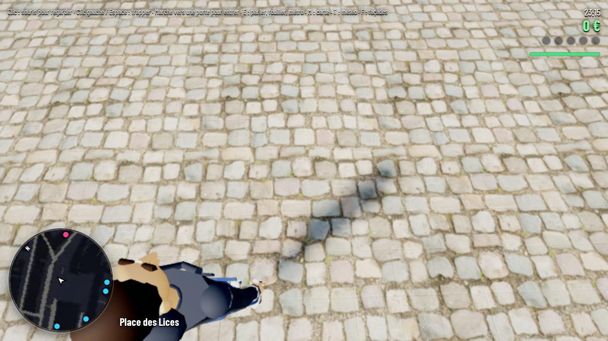

# Contrôle automatique — OK avec réserves

Commit `7697830` · 2026-11-26 11:18 UTC · chargement 144 s · 0.5 images/s en rendu logiciel (précédent : 0.38)

## Réserves
- Contrôle incomplet : le script de test n'a pas pu jouer m8, m9 (problème du banc de test, pas forcément du jeu). Ces missions sont marquées « non vérifiée ».
- Rue Maréchal Joffre, jour : image délavée (luminosité moyenne 0.611, saturation 0.236 ; une photo de rue en plein jour tourne autour de 0,40-0,50 de luminosité et 0,20-0,30 de saturation).
- Rue Saint-Michel, jour : image délavée (luminosité moyenne 0.599, saturation 0.127 ; une photo de rue en plein jour tourne autour de 0,40-0,50 de luminosité et 0,20-0,30 de saturation).
- Place des Lices, escalier, jour : image délavée (luminosité moyenne 0.72, saturation 0.142 ; une photo de rue en plein jour tourne autour de 0,40-0,50 de luminosité et 0,20-0,30 de saturation).
- Halles des Lices, jour : image délavée (luminosité moyenne 0.684, saturation 0.168 ; une photo de rue en plein jour tourne autour de 0,40-0,50 de luminosité et 0,20-0,30 de saturation).

## Rendu
**Changement visuel : net.** 4 vues sur 6 changent nettement. Regarder les comparaisons pour juger si c'est mieux.

## Missions
| Mission | Résultat |
|---|---|
| Mission 1 | OK |
| Mission 2 | OK |
| Mission 3 | OK |
| Mission 4 | OK |
| Mission 5 | OK |
| Mission 6 | OK |
| Mission 7 | OK |
| Mission 8 | non vérifiée |
| Mission 9 | non vérifiée |
| Fight club | OK |

## Accès aux éléments de mission
- OK — Thabor (à pied, depuis la rue de Paris)
- OK — Thabor (en voiture, depuis le bd de la Duchesse-Anne)
- OK — Mission 3 : les 3 sacs tirés sont accessibles à pied

## Vues fixes
Changement = part de l’image qui change nettement par rapport au contrôle précédent (moins de 10 % : anecdotique). Entre parenthèses : écart avec le contrôle précédent.

| Vue | Changement | Luminosité | Contraste | Saturation | Quasi blanc |
|---|---|---|---|---|---|
| Rue Maréchal Joffre, jour | 50 % | 0.611 (+0.012) | 0.243 (-0.02) | 0.236 (-0.024) | 3 % |
| Rue Saint-Michel, jour | 1 % | 0.599 (+0.0) | 0.221 (+0.0) | 0.127 (+0.001) | 5 % |
| Place des Lices, escalier, jour | 55 % | 0.72 (+0.007) | 0.151 (-0.004) | 0.142 (+0.019) | 6 % |
| Halles des Lices, jour | 33 % | 0.684 (-0.012) | 0.19 (+0.007) | 0.168 (+0.011) | 13 % |
| Place des Lices, nuit sous la pluie | 27 % | 0.234 (+0.0) | 0.15 (+0.0) | 0.342 (-0.006) | 0 % |
| Toits du centre vus d’en haut | 0 % | 0.701 (+0.0) | 0.134 (+0.0) | 0.127 (+0.0) | 8 % |

Comparaisons avant (en haut) / après (en bas) :


Captures actuelles :





## Problèmes du script de test (pas du jeu)
```
m8 : Page.evaluate: TypeError: Cannot read properties of undefined (reading 'x')
m9 : Page.evaluate: TypeError: Cannot read properties of undefined (reading 'x')
```

---
Ce rapport est produit par `tests/ci.py` (workflow « Contrôle automatique »). Les règles de travail sont dans `AGENTS.md`.
