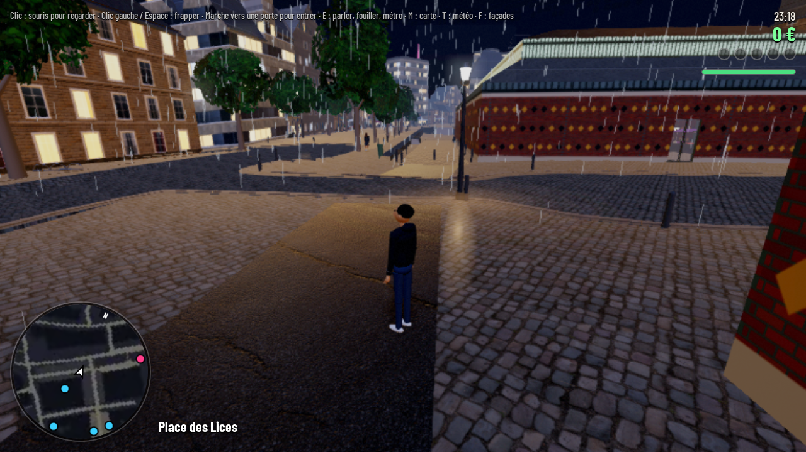

# Contrôle automatique — OK avec réserves

Commit `c31c2eb` · 2026-11-26 16:22 UTC · chargement 83 s · 0.286 images/s en rendu logiciel

## Réserves
- Rue Saint-Michel, jour : image délavée (luminosité moyenne 0.611, saturation 0.184 ; une photo de rue en plein jour tourne autour de 0,40-0,50 de luminosité et 0,20-0,30 de saturation).
- Place des Lices, escalier, jour : image délavée (luminosité moyenne 0.631, saturation 0.172 ; une photo de rue en plein jour tourne autour de 0,40-0,50 de luminosité et 0,20-0,30 de saturation).
- Halles des Lices, jour : image délavée (luminosité moyenne 0.649, saturation 0.159 ; une photo de rue en plein jour tourne autour de 0,40-0,50 de luminosité et 0,20-0,30 de saturation).

## Rendu
Images par seconde : 0.286 sur une machine de vitesse 12.171 (référence en construction, 1/3 contrôles).

## Missions
| Mission | Résultat |
|---|---|
| Mission 1 | OK |
| Mission 2 | OK |
| Mission 3 | OK |
| Mission 4 | OK |
| Mission 5 | OK |
| Mission 6 | OK |
| Mission 7 | OK |
| Mission 8 | OK |
| Mission 9 | OK |
| Fight club | OK |

## Accès aux éléments de mission
- OK — Mission 3 : les 3 sacs tirés sont accessibles à pied
- OK — Thabor (à pied, depuis la rue de Paris)
- OK — Thabor (en voiture, depuis le bd de la Duchesse-Anne)

## Vues fixes
Changement = part de l’image qui change nettement par rapport au contrôle précédent (moins de 10 % : anecdotique). Entre parenthèses : écart avec le contrôle précédent.

| Vue | Changement | Luminosité | Contraste | Saturation | Quasi blanc |
|---|---|---|---|---|---|
| Rue Maréchal Joffre, jour | — | 0.519 | 0.233 | 0.268 | 4 % |
| Rue Saint-Michel, jour | — | 0.611 | 0.193 | 0.184 | 10 % |
| Place des Lices, escalier, jour | — | 0.631 | 0.155 | 0.172 | 8 % |
| Halles des Lices, jour | — | 0.649 | 0.181 | 0.159 | 17 % |
| Place des Lices, nuit sous la pluie | — | 0.217 | 0.141 | 0.354 | 0 % |
| Toits du centre vus d’en haut | — | 0.666 | 0.149 | 0.152 | 4 % |

Captures actuelles :

---
Ce rapport est produit par `tests/ci.py` (workflow « Contrôle automatique »). Les règles de travail sont dans `AGENTS.md`.
