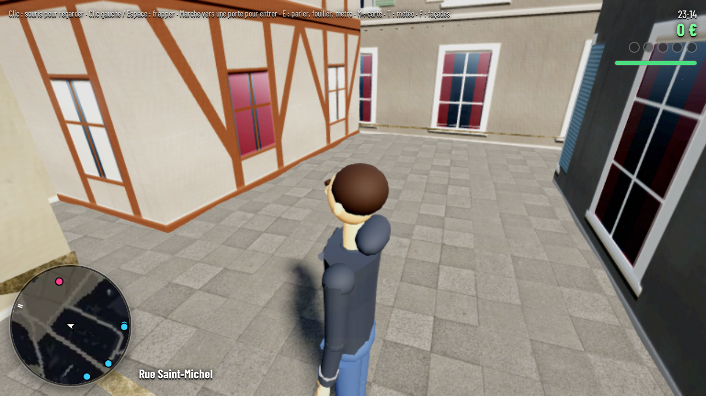
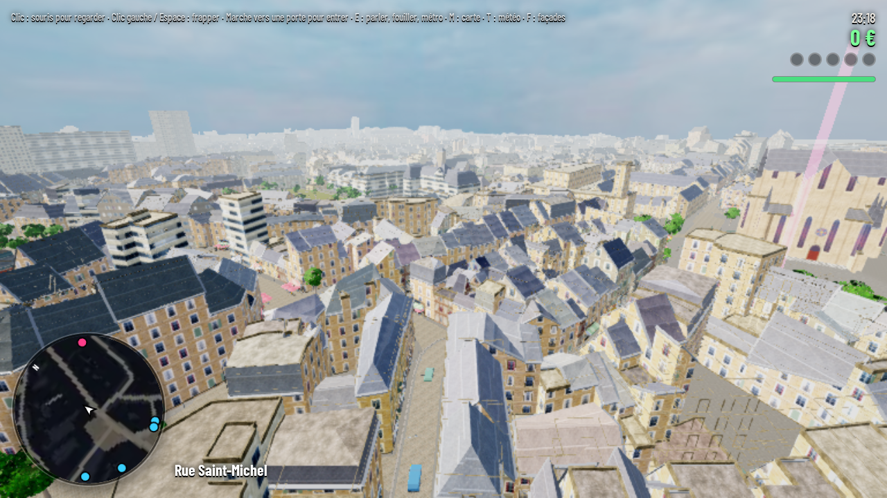

# Contrôle automatique — OK avec réserves

Commit `5eb1db0` · 2026-11-26 13:20 UTC · chargement 142 s · 0.5 images/s en rendu logiciel (précédent : 0.38)

## Réserves
- Contrôle incomplet : le script de test n'a pas pu jouer m8, m9 (problème du banc de test, pas forcément du jeu). Ces missions sont marquées « non vérifiée ».
- Place des Lices, escalier, jour : image délavée (luminosité moyenne 0.591, saturation 0.218 ; une photo de rue en plein jour tourne autour de 0,40-0,50 de luminosité et 0,20-0,30 de saturation).
- Halles des Lices, jour : image délavée (luminosité moyenne 0.638, saturation 0.174 ; une photo de rue en plein jour tourne autour de 0,40-0,50 de luminosité et 0,20-0,30 de saturation).

## Rendu
**Changement visuel : net.** 4 vues sur 6 changent nettement. Regarder les comparaisons pour juger si c'est mieux.

## Missions
| Mission | Résultat |
|---|---|
| Mission 1 | OK |
| Mission 2 | OK |
| Mission 3 | OK |
| Mission 4 | OK |
| Mission 5 | OK |
| Mission 6 | OK |
| Mission 7 | OK |
| Mission 8 | non vérifiée |
| Mission 9 | non vérifiée |
| Fight club | OK |

## Accès aux éléments de mission
- OK — Mission 3 : les 3 sacs tirés sont accessibles à pied
- OK — Thabor (à pied, depuis la rue de Paris)
- OK — Thabor (en voiture, depuis le bd de la Duchesse-Anne)

## Vues fixes
Changement = part de l’image qui change nettement par rapport au contrôle précédent (moins de 10 % : anecdotique). Entre parenthèses : écart avec le contrôle précédent.

| Vue | Changement | Luminosité | Contraste | Saturation | Quasi blanc |
|---|---|---|---|---|---|
| Rue Maréchal Joffre, jour | 64 % | 0.507 (-0.047) | 0.225 (-0.032) | 0.268 (+0.018) | 1 % |
| Rue Saint-Michel, jour | 49 % | 0.532 (+0.082) | 0.222 (-0.013) | 0.191 (+0.037) | 2 % |
| Place des Lices, escalier, jour | 61 % | 0.591 (-0.025) | 0.136 (-0.026) | 0.218 (+0.048) | 0 % |
| Halles des Lices, jour | 0 % | 0.638 (-0.01) | 0.185 (-0.004) | 0.174 (+0.014) | 15 % |
| Place des Lices, nuit sous la pluie | 25 % | 0.215 (-0.014) | 0.141 (-0.006) | 0.352 (+0.002) | 0 % |
| Toits du centre vus d’en haut | 0 % | 0.666 (-0.001) | 0.147 (+0.0) | 0.15 (+0.0) | 4 % |

Comparaisons avant (en haut) / après (en bas) :


Captures actuelles :







## Problèmes du script de test (pas du jeu)
```
m8 : Page.evaluate: TypeError: Cannot read properties of undefined (reading 'x')
m9 : Page.evaluate: TypeError: Cannot read properties of undefined (reading 'x')
```

---
Ce rapport est produit par `tests/ci.py` (workflow « Contrôle automatique »). Les règles de travail sont dans `AGENTS.md`.
