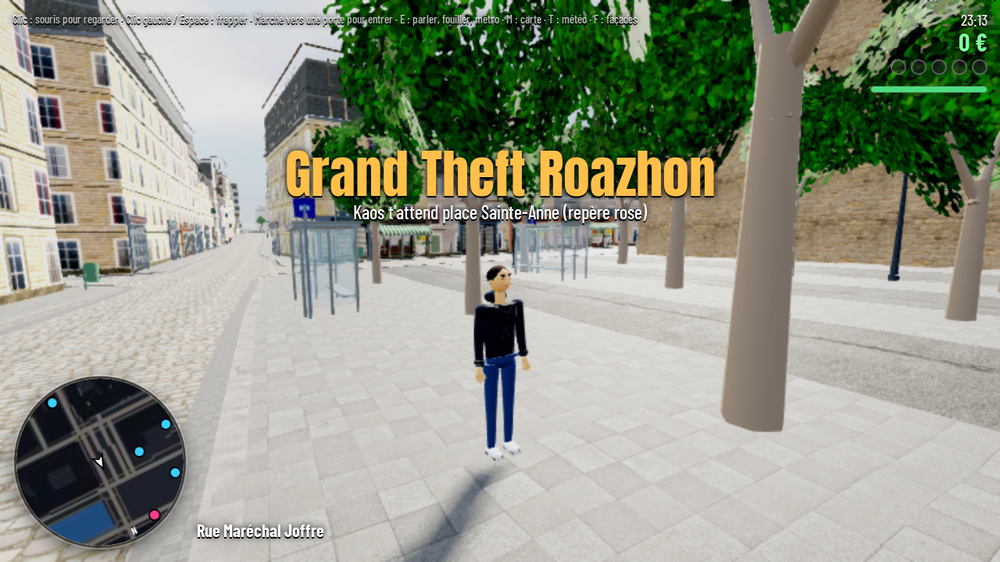

# Contrôle automatique — KO

Commit `a69cfb2` · 2026-11-26 10:48 UTC · chargement 191 s · 0.38 images/s en rendu logiciel

## Bloquant (à corriger avant tout autre changement)
- 2 erreur(s) JavaScript pendant la partie (détail plus bas).
- Mission 8 ne se termine plus.
- Mission 9 ne se termine plus.

## Réserves
- Rue Maréchal Joffre, jour : image délavée (luminosité moyenne 0.599, saturation 0.26 ; une photo de rue en plein jour tourne autour de 0,40-0,50 de luminosité et 0,20-0,30 de saturation).
- Rue Saint-Michel, jour : image délavée (luminosité moyenne 0.599, saturation 0.126 ; une photo de rue en plein jour tourne autour de 0,40-0,50 de luminosité et 0,20-0,30 de saturation).
- Place des Lices, escalier, jour : image délavée (luminosité moyenne 0.713, saturation 0.123 ; une photo de rue en plein jour tourne autour de 0,40-0,50 de luminosité et 0,20-0,30 de saturation).
- Halles des Lices, jour : image délavée (luminosité moyenne 0.696, saturation 0.157 ; une photo de rue en plein jour tourne autour de 0,40-0,50 de luminosité et 0,20-0,30 de saturation).

## Missions
| Mission | Résultat |
|---|---|
| Mission 1 | OK |
| Mission 2 | OK |
| Mission 3 | OK |
| Mission 4 | OK |
| Mission 5 | OK |
| Mission 6 | OK |
| Mission 7 | OK |
| Mission 8 | **KO** |
| Mission 9 | **KO** |
| Fight club | OK |

## Accès aux éléments de mission
- OK — Thabor (à pied, depuis la rue de Paris)
- OK — Thabor (en voiture, depuis le bd de la Duchesse-Anne)
- OK — Mission 3 : les 3 sacs tirés sont accessibles à pied

## Vues fixes
Changement = part de l’image qui change nettement par rapport au contrôle précédent (moins de 10 % : anecdotique). Entre parenthèses : écart avec le contrôle précédent.

| Vue | Changement | Luminosité | Contraste | Saturation | Quasi blanc |
|---|---|---|---|---|---|
| Rue Maréchal Joffre, jour | — | 0.599 | 0.263 | 0.26 | 5 % |
| Rue Saint-Michel, jour | — | 0.599 | 0.221 | 0.126 | 5 % |
| Place des Lices, escalier, jour | — | 0.713 | 0.155 | 0.123 | 10 % |
| Halles des Lices, jour | — | 0.696 | 0.183 | 0.157 | 15 % |
| Place des Lices, nuit sous la pluie | — | 0.234 | 0.15 | 0.348 | 0 % |
| Toits du centre vus d’en haut | — | 0.701 | 0.134 | 0.127 | 8 % |

Captures actuelles :




## Erreurs JavaScript
```
scénario m8 : Page.evaluate: TypeError: Cannot read properties of undefined (reading 'x')
    at eval (eval at evaluate (:234:30), <anonymous>:1:119)
    at UtilityScript.evaluate (<anonymous>:241:19)
    at Utilit
scénario m9 : Page.evaluate: TypeError: Cannot read properties of undefined (reading 'x')
    at eval (eval at evaluate (:234:30), <anonymous>:1:90)
    at UtilityScript.evaluate (<anonymous>:241:19)
    at Utility
```

---
Ce rapport est produit par `tests/ci.py` (workflow « Contrôle automatique »). Les règles de travail sont dans `AGENTS.md`.
